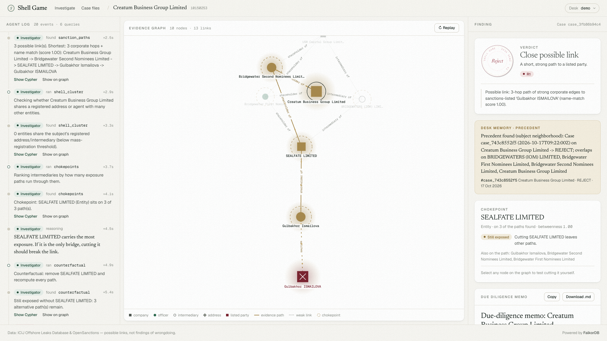

# Shell Game

**Who are you about to do business with?** Give Shell Game a company or a person. Three agents trace
officers, nominee shareholders, intermediaries and shared registered addresses through the
**ICIJ Offshore Leaks** graph toward parties on **OpenSanctions** lists, argue about the weakest link,
and return a verdict with the graph path as proof: **APPROVE**, **EDD** (enhanced due diligence) or **REJECT**.

Built for **Graph Hacks: Context for AI Agents** (WeMakeDevs × FalkorDB).
Tracks: **01 Agents That Act on Connected Data** (primary) · **02 Agent Memory and Coordination**.

- **Live app:** https://shellgame-khaki.vercel.app · **API:** https://shellgame-production-9c95.up.railway.app/api/health
- **Demo video:** https://youtu.be/bca5HMEDGkI · **Blog post:** https://dev.to/mightyasjed/shell-game-three-agents-one-graph-and-a-3-hop-path-to-a-sanctions-list-2llg

> Possible links, not findings of wrongdoing. Data: ICIJ Offshore Leaks Database and OpenSanctions (both public).



## Why a graph

The evidence only exists as a path. *Creatum Business Group Ltd* (BVI) looks unremarkable on its own.
Its shareholder *Bridgewater Second Nominees* is also a shareholder of *Sealfate Ltd*, whose shareholder
*Gulbakhor Ismailova* matches an OpenSanctions-listed person (Estonia's International Sanctions Act list). That is three hops. A row lookup
or a vector search can't find it, and a single Cypher traversal on FalkorDB finds it in milliseconds.
"No path within 6 hops" is also a real answer: it is a provable negative in this dataset.

Remove FalkorDB and nothing works. Every answer is a traversal, every verdict cites the path, and every
tool result in the UI shows the exact Cypher and parameters that produced it.

## How it works

```
             ┌──────────── FalkorDB ────────────┐
 subject ──▶ │ shellgame graph (242k nodes)      │ ◀── fixed, parameterised Cypher tools (read-only)
             │ cases_<desk> graphs (memory)      │ ◀── one isolated graph per desk/tenant
             └──────────────────────────────────┘
 Investigator ─ picks tools ─▶ sanction_paths · shell_cluster · chokepoints · counterfactual · recall
 Skeptic      ─ attacks each path: weak edges (SIMILAR / SAME_NAME_AS), token-only name matches
 Gatekeeper   ─ deterministic rules ─▶ verdict + memo citing node ids and the Cypher used ─▶ Case saved
```

- **The LLM never writes Cypher.** It chooses among human-written tools with typed arguments, and node
  ids it invents are rejected. Without an API key the same agents run a scripted plan, so the demo is
  reproducible.
- **The verdict is deterministic.** An LLM can explain the verdict but cannot change it.

| Rule | Verdict |
|---|---|
| R1 | REJECT: path to a sanctioned party with ≤ 5 ICIJ hops, no weak edge, name-match score ≥ 0.95, not weakened by the Skeptic |
| R2 | EDD: path within 6 hops but weakened (weak edge, score < 0.95, or token-only match) |
| R3 | EDD: strong path, but longer than 5 ICIJ hops |
| R4 | EDD: ≥ 25 entities share the subject's registered address (mass registration) |
| R5 | APPROVE: no path within 6 hops and no cluster signal |

**Counterfactual.** "Cut" any node in the UI, or let the agent cut the top chokepoint. The paths are
recomputed without that node, which shows whether one nominee carries the whole exposure.

**Memory (Track 2).** Every investigation is written as a `Case` into the desk's own graph
(`cases_<desk>`), with `EXAMINED`, `FLAGGED` and `CLEARED` edges to the nodes it touched. The next
investigation that reaches any of those nodes recalls the precedent, for example "Coral Nominees was flagged in
case #7", and links the two cases with `PRECEDENT_FOR`. Desks are separate FalkorDB graphs in one instance,
so nothing leaks between tenants.

## Graph data model

```
(:Node:Entity|Officer|Intermediary|Address|Other {id, name, name_norm, jurisdiction, countries, source})
(:Node)-[:OFFICER_OF|INTERMEDIARY_OF|REGISTERED_ADDRESS|SAME_AS|SIMILAR|SAME_NAME_AS|… {link, w}]->(:Node)
(:Node)-[:MATCHES {score, method: exact|alias|token, w}]->(:Sanction {id, name, schema, programs, countries})

(:Case {id, created_at, subject_id, verdict, summary})-[:EXAMINED|FLAGGED|CLEARED]->(:Ref {id, name, kind})
(:Case)-[:PRECEDENT_FOR]->(:Case)
```

Edge weight `w` sets evidence strength: registry links are 1, "similar name" links are 3, and name matches
are 1 when the score is ≥ 0.95. Indexes: range indexes on `id` and `name_norm`, and full-text indexes on
`name`. The ingest and matching rules are in [`backend/DATA.md`](backend/DATA.md).

**Real graph:** 241,847 nodes, 506,015 edges and 1,118 matched sanctioned parties, from 1,712 name matches
(503 exact, 602 alias, 607 token). The focus subgraph is everything within 3 hops of a match, plus a
40k-company random background so ordinary companies exist. Path search: median 0.03 s, p95 2 s.

## The Cypher the product depends on

```cypher
// sanction_paths / counterfactual: exact layered BFS inside FalkorDB, one query per hop
UNWIND $frontier AS i MATCH (n) WHERE ID(n) = i WITH n, i
MATCH (n)-[r]-(m) WHERE r.w <= $max_w AND m.id <> $remove_id
RETURN i, ID(m), m:Sanction

// chokepoints: where a nominee sits in the wider offshore network (FalkorDB PageRank)
CALL algo.pageRank('Node', NULL) YIELD node, score
WITH collect({id: node.id, s: score}) AS all
UNWIND [x IN all WHERE x.id IN $ids] AS c
RETURN c.id, size([y IN all WHERE y.s > c.s]) * 100.0 / size(all)

// shell_cluster: mass-registration signal
MATCH (s:Node {id: $id})
OPTIONAL MATCH (s)-[:REGISTERED_ADDRESS*0..1]-(a:Address)-[:REGISTERED_ADDRESS]-(m:Entity)
RETURN count(DISTINCT a), count(DISTINCT m)

// search
CALL db.idx.fulltext.queryNodes('Node', $q) YIELD node, score RETURN node, score ORDER BY score DESC LIMIT $limit

// memory: recall precedents for the nodes we are about to examine
MATCH (c:Case)-[rel:EXAMINED|FLAGGED|CLEARED]->(r:Ref) WHERE r.id IN $ids
RETURN c, collect(DISTINCT {id: r.id, name: r.name, rel: type(rel)}) AS hits ORDER BY c.created_at DESC LIMIT $limit
```

Why a BFS and not `algo.SPpaths`? On the real graph, shortest-path enumeration wandered through hub
nodes (law firms with thousands of client companies) and sometimes ran for over 60 s. The layered BFS stops
at the first hop that reaches a sanctioned party and rebuilds only the shortest paths, which keeps
search interactive.

## Try it

Four real subjects (ICIJ node ids) give each verdict:

| Subject | Verdict | Why |
|---|---|---|
| Creatum Business Group Ltd `10150253` | REJECT | Shares a nominee shareholder with Sealfate Ltd, whose shareholder matches Gulbakhor Ismailova on sanctions lists (3 hops, exact) |
| USM Finance Ltd `10161731` | REJECT | Its beneficiary "Tavrin Ivan" matches Ivan Vladimirovich Tavrin (1 hop, alias) |
| Iris Rose Holdings Corp `20141145` | EDD (R3) | A strong but 6-hop path to Vladimir Kovalenko |
| Bison Management Ltd `20126388` | APPROVE | No path within 6 hops |

## Run locally

```bash
# Backend (Python 3.13). Uses embedded FalkorDB (falkordblite) unless FALKORDB_URL points at a server.
cd backend && pip install -r requirements.txt
python -m shellgame.ingest --icij ../data/sample --sanctions ../data/sample/targets.simple.csv --reset   # synthetic sample
FALKORDB_LITE_PATH=../data/real.db uvicorn shellgame.api:app --port 8000                                 # or the real graph
pytest -q                                                                                                # 26 tests

# Frontend (Node 20+)
cd frontend && npm install
NEXT_PUBLIC_API_URL=http://localhost:8000 npm run dev      # NEXT_PUBLIC_MOCK=1 runs without a backend
```

To use a FalkorDB server instead, run `docker run -p 6379:6379 falkordb/falkordb` and set
`FALKORDB_URL=redis://localhost:6379`. To rebuild the real graph from source, download
`full-oldb.LATEST.zip` (ICIJ) and `targets.simple.csv` (OpenSanctions sanctions dataset), then:

```bash
FALKORDB_LITE_PATH=.data/real.db python -m shellgame.ingest --icij full-oldb.LATEST.zip \
  --sanctions targets.simple.csv --focus-hops 3 --max-nodes 250000 --background 40000 --reset
```

Optional LLM: set `ANTHROPIC_API_KEY` or `OPENAI_API_KEY` and the Investigator picks its own tools.

**Offline fallback:** if the live API can't be reached, the frontend replays real investigation streams recorded from the live system for the four example companies (`frontend/public/replays`, made by `frontend/scripts/record_replays.py`), clearly labelled as a recording.

**Deploy:**
- API: Railway builds `backend/Dockerfile` (see `railway.json`). `deploy/hf-space` works on a paid Hugging Face Docker Space.
- Frontend: Vercel with root directory `frontend` and `NEXT_PUBLIC_API_URL` set.

## Stack

- **Database:** FalkorDB, with Cypher and the `algo.pageRank` procedure.
- **Backend:** FastAPI streaming agent events over SSE.
- **Frontend:** Next.js 14, Tailwind, react-force-graph.
- **Data:** ICIJ Offshore Leaks and OpenSanctions.

## Responsible use

- **Data:** only public datasets are used.
- **Wording:** the product shows *possible links* and their strength, never conclusions.
- **Name matching is strict:**
  - names need at least 2 tokens and 8 characters;
  - countries must overlap when both sides list them;
  - names matching more than 5 different records are dropped.

  Even so, matches can be wrong, which is why the Skeptic and the evidence path are always shown.

## AI assistance disclosure

This project was built with AI coding assistants (Claude), as the hackathon rules allow. The author
directed the idea, architecture and data choices, reviewed the code, and verified results against the
real data.
